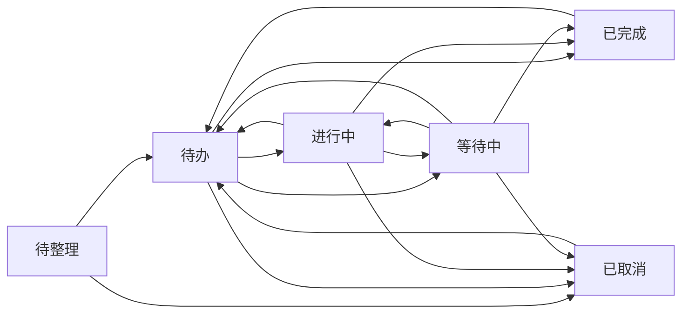

# 产品与交互

本文件定义当前产品基线。更新：2026-10-13。

## 1. 定位与成功标准

WorkOS 是个人工作上下文与事项追踪工具，服务于多项目并行、频繁被打断、需要等待和跟进他人的工作。每天打开，应能回答：今天做什么、什么不能忘、我在等谁、上次做到哪里。

用户只记录事实一次，系统负责重新组织。项目可选，记录只要求一句标题，不让用户为了完成任务再补工作记录、项目现状或日报。

体验目标：记录约 3 秒；收件箱整理一条不超过 30 秒；完成只点一次；进入等待约 10 秒；恢复项目上下文约 10 秒；日报准备不超过 3 分钟。这些是验收目标，不是已经测得的性能指标。

## 2. 领域术语

| 概念 | 定义与边界 |
|---|---|
| 项目 Project | 一组工作的上下文，包含目标、重点、进展、阻塞、下一步和关键人/链接。项目不是强制分类条件 |
| 事项 Item | 一个可闭环的事实或工作单位。只有任务 TASK、笔记 NOTE 两种类型 |
| 任务 | 有共同完成标准的一件工作。若每个项目必须分别验收、分别完成，应拆成不同任务 |
| 笔记 | 保存信息，不参与任务执行、Today 计划及完成事项日报。界面 DONE 叫“已保存” |
| 状态 | 待整理、待办、进行中、等待中、已完成、已取消；表示工作进度 |
| 计划 | 用户决定哪天做，独立于状态。今天不是新状态，安排今天不等于已经开始 |
| 等待 | 等别人提供结果，至少要填写“等谁”；结束等待清理等待字段 |
| 跟进 | 在指定时间主动推动事项的能力，不是事项类型，也不一定处于等待状态 |
| 工作记录 WorkLog | 人工补充的事实：做了什么、为何决定、沟通结果。按当时的主项目归集 |
| 系统事件 Activity | 创建、状态转换、属性变更等审计，不作为工作内容重复写进日报 |
| 日报 Daily | 正文＋生成快照。生成不覆盖正文，明确应用后才覆盖 |
| 提醒 Reminder | 展示层提醒，不改变事项状态或跟进日期。后台接口存在，完整客户端能力尚未交付 |

## 3. 快速记录与整理

- 一句标题即可保存，默认 TASK、P2。失败保留输入；中文输入法选词回车不提交。
- 今天页默认“今天做”：原子创建待办并安排到业务日今天。收件箱默认“先记下，待整理”。
- 全局“记录事项”随时可用，快捷键 `⌘/Ctrl + Shift + K`；这只是浏览器内快捷键。
- 记录可选择今天做、待办、待整理。在项目详情记录默认待办，并继承该主项目，可改成今天做。
- 收下任务：待整理→待办；收下笔记：待整理→已保存。无需先填项目、优先级或日期。
- 批量收下只处理 INBOX，保留已有项目、关联项目和优先级。收下不等于已经安排计划。
- 全局记录浮窗关闭后保留当前页面会话草稿；不承诺断网自动同步或刷新后恢复。

## 4. 状态及流转辅助

任务的合法转换表是完整规则；主流程只是使用说明，允许跳过“进行中”直接完成。

| 当前状态 | 允许到达 |
|---|---|
| 待整理 INBOX | 待办、已取消 |
| 待办 TODO | 进行中、等待中、已完成、已取消 |
| 进行中 DOING | 待办、等待中、已完成、已取消 |
| 等待中 WAITING | 待办、进行中、已完成、已取消 |
| 已完成 DONE | 待办 |
| 已取消 CANCELLED | 待办 |

笔记只允许：待整理→已保存/已取消；已保存/已取消→待整理。物理删除只允许待整理，已整理事项用取消并保留历史。

**状态图评估**：完整图适合文档，但双向箭头多，不适合作为每日操作界面。详情使用“当前状态→允许的下一步”局部图，突出当前位置，点击目标即可执行，允许目标来自后端。等待打开所需表单，取消二次确认。图可收起，行内开始/等待/完成仍保留。

完成只修改任务状态及完成时间，不强迫写日志。恢复后清除关闭时间，保留历史。等待必须有对象；离开等待清除等待信息和这一段的跟进时间。

## 5. 今天与全部事项

Today 只展示可执行 TASK，以后端业务日计算。按下表顺序分区，先命中的不重复展示；任务可同时带多个事实标签。

| 顺序 | 内容 |
|---|---|
| 1 今日计划 | 计划日期为今天，状态为待办/进行中/等待中 |
| 2 已逾期 | 截止时间早于今天起始，状态待办/进行中 |
| 3 今日到期 | 截止时间落在今天，状态待办/进行中 |
| 4 到点跟进 | 跟进时间已到，且任务未关闭、已整理 |
| 5 其他等待 | 等待中且尚未到跟进时间，前面的分区没有展示 |
| 6 旧计划 | 计划日期早于今天，尚未关闭，前面没有展示 |
| 7 待安排候选 | 未计划的待办/进行中，按优先级、截止时间、最近更新、ID 排序，最多 5 条 |

界面归成今日计划、今天别忘了、还没安排和右侧辅助信息。“其他等待事项”的数量只指该列表，不是所有等待任务总数。

- 今日计划建议 3 件，不设硬上限。旧计划不自动结转，由用户重新安排。
- 未来计划不能屏蔽已经发生的逾期/到点跟进；今日计划里的风险通过行内标签展示。
- 候选区只是快捷入口，不能代替完整待办列表；始终提供“从全部待办选择”。
- 全部事项默认未完成，支持待整理、待办、进行中、等待、完成、取消、项目、优先级、未分类及关键词筛选和分页。
- 无项目表示未分类；存在关联项目时必须有主项目。“未分类”不是必须清零的指标。

## 6. 主项目与关联项目

决策：**一个主项目＋零到多个关联项目，共享一个事项 ID、一套状态、日期、工作记录和历史。** 用户已确认此方案。

例如“统一升级 code2name”：主项目为基础平台，关联政务门户和厂商接入。三个项目都能找到同一事项；任意入口标为完成，其他项目立即反映同一结果。

- 主项目决定工作记录和日报归集。关联项目提供查找及上下文入口，不复制任务。
- 项目筛选、项目内待办/进行中/等待及项目计数均包含主归属和关联；同一项目内只计一次。项目之间的计数不可相加当作全局总数。
- Today 及全局列表以事项 ID 去重；日报不会因关联多个项目多写一次。
- 关联项目批量选择后一次保存，取消恢复已保存值。最多 20 个，主项目不会同时作为自己的关联项目。
- 更换主项目时从关联列表去掉新主项目，其他关联保留；原主项目不自动转成关联。清空主项目前需显式移除关联项目。
- 更换主项目不重写过去的工作记录；新记录归新主项目，历史记录保留当时归属。
- 归档项目不删除事项或关联；归档项目可从列表切换进入并恢复。选项保留现有关联名称。
- 如果三个项目需要不同负责人、不同完成时间或独立进度，应建三件任务；共享任务不能表达三份独立进度。

不选择“多个平等归属”的原因：归集、排序和日报主线容易模糊；不默认复制事项的原因：用户会被迫维护多份同一进度。

## 7. 等待、跟进、记录与日报

等待对象、对方预计时间、我下次推动时间是三个不同事实，不互相替代。到点跟进提供“还没回 / 对方给了 / 暂时不跟”；对方给了可回到待办、进行中或完成，清理本次跟进时间。任务本来已进行中时允许保持状态完成跟进。

每个事项可记一句补充事实；所有项目入口共看同一条记录。状态事件不自动冒充人工工作记录。描述里的 `- [ ]` 清单只用于显示剩余步数，不升级成独立子任务。

日报按工作日记录生成快照，完成任务作为独立段落。生成返回新版本，正文保持不变；预览里明确“应用并覆盖正文”。关闭抽屉、离开项目编辑或日报切日/离页应保护未保存输入；保存失败保留草稿。

## 8. 本轮需求挑战与结果

| 问题 | 判断与调整 |
|---|---|
| 是否所有记录都该先过 Inbox？ | 否。已明确今天做的事直接入计划，临时想法才待整理 |
| 是否必须开始后才能完成？ | 否。短任务允许直接完成，减少维护步骤 |
| 状态越多是否越清楚？ | 否。保留现有状态，用下一步图和可见动作解释；计划独立 |
| 多项目是否应复制任务？ | 共享完成标准的只建一件；独立进度才拆分 |
| 项目是否只是事后分类？ | 否。项目详情直接记录并继承主项目，降低恢复工作成本 |
| 归档是否意味着任务消失？ | 否。提供归档项目入口，关联和事项保留 |
| 文档越全是否越可靠？ | 规则只保留一个解释处，字段用代码与 SQL 查证，完整性靠范围与验收表 |

## 9. 范围与待完成需求

当前交付：macOS 桌面与 Web 共用核心记录、整理、任务执行、等待跟进、今日计划与旧计划、主项目/关联项目、项目现状、按日生成与应用日报、列表查询、局部状态图、独立丰富示例工作区。

| 原需求/能力 | 当前边界与后续验收方向 |
|---|---|
| 断网捕获队列 | 尚未实现；需持久化、重试、幂等及待同步提示。当前保存失败仅保留输入 |
| 桌面快捷键与通知 | 桌面壳复用应用窗口内快捷键；系统全局快捷键与后台通知后置 |
| Reminder / 跟进工作台 | 有后端接口，完整入口、启动补偿和通知通道待做；忽略提醒不得改变跟进事实 |
| 本周日报、Markdown 预览和大纲 | 聚合接口存在；完整前端尚未交付，不能声称已支持周报编辑 |
| 全局搜索和轻量前缀 | API 存在；当前事项关键词筛选不等于跨项目/记录/日报搜索 |
| 项目工作记录/日报聚合 | 事项抽屉可看共享记录，独立项目聚合视图待做 |
| 原地勾选清单、计划拖动、收工复盘 | 剩余步数和计划接口存在；完整交互待做 |
| 手机只读与速记 | 当前以桌面为主，375px 专项验收待做 |
| 用户选择示例/直接开始 | 当前提供独立示例库和启动方式；首次使用选择页待做 |
| 自动备份、Markdown/JSON 导出 | 桌面提供每日自动备份、手动备份及恢复；异地备份和 Markdown/JSON 导出后置 |
| 登录与安全访问 | 桌面仅本机会话访问；Web 用户登录尚未实现，不用于公网共享 |
| 设置页、系统时区初始化 | 后端设置可用，界面和首次时区检测待做；当前默认 Asia/Shanghai |
| 项目重命名、NOTE 类型切换 | 后端属性接口可用，完整前端入口待补；不要把 API 存在当作界面可用 |

不引入团队权限、聊天、子任务体系、Tag、日历/Gantt、外部系统同步、AI 排序或自动推断承诺。后续需求应证明能减少维护成本，而不是增加可配置项。

## 10. 桌面使用边界

macOS 桌面版的目标是双击即可继续工作，无需每天启动服务或维护数据库。保留原业务交互，增加“数据与备份”：空工作区可复制原本机工作库或示例库，导入后独立保存，也可直接开始新工作。导入前明确两端不自动同步，不能把桌面当作原 Web 数据库的第二个窗口。

关闭窗口保留应用，点击 Dock 或状态栏可继续；退出应用则完整停止。休眠时应用暂停，唤醒后继续使用，不改变电脑电源策略。数据留在用户目录，替换应用包不清空记录。恢复备份属于覆盖操作，必须说明后果并保留恢复前副本；自动备份不能替代用户将重要数据另存到其他设备。

首期为单机单用户、手动更新；云同步、多设备协作、Windows、系统级快捷键和通知不纳入本轮。
